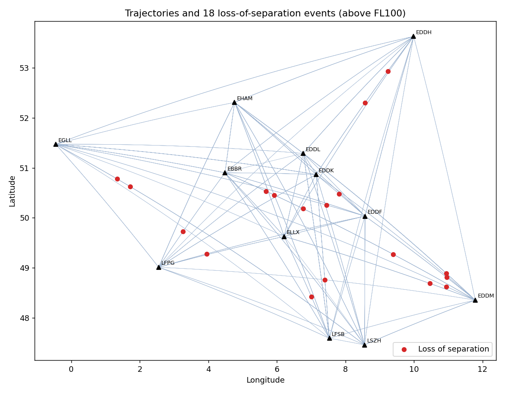
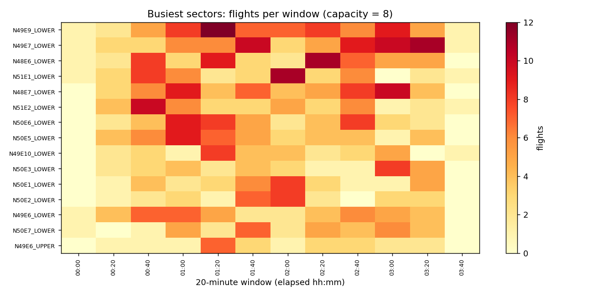

# Airspace Conflict & Sector Hotspot Detector

Python toolkit that processes aircraft trajectories (synthetic, or real
ADS-B state vectors from the [OpenSky Network](https://opensky-network.org/))
and answers three ATM questions:

1. **Where did aircraft lose separation?** Detects every loss of separation
   (horizontal < 5 NM **and** vertical < 1000 ft, en-route above FL100).
2. **Could we have seen it coming?** Short-term conflict prediction by linear
   extrapolation to the closest point of approach (CPA), with up to a 5-minute
   look-ahead, and measures how many seconds of warning each alert gave.
3. **Which sectors are overloaded?** Counts flights per sector per 20-minute
   window on a 1°×1° grid split into lower/upper airspace, and flags windows
   above capacity.



## Results (synthetic scenario: 500 flights, 12 Central European airports, 4 h)

| Metric | Value |
|---|---|
| Positions processed | 91,991 |
| Loss-of-separation events | 18 |
| Detection runtime | ~2.5 s (KD-tree search) |
| Events predicted before they happened | 77.8% |
| Median warning time | 130 s |
| Overloaded sector-windows (capacity 8) | 14 |

The missed predictions are mostly pairs in climb or descent, where a
straight-line extrapolation of the vertical profile is weak. That is a known
limitation of linear STCA-style prediction and a natural next step
(see below).



## How it works

- **Geodesy**: haversine distances and great-circle interpolation (`geo.py`).
- **Trajectories**: climb / cruise / descent profiles with semicircular
  flight-level rule (eastbound odd, westbound even levels); OpenSky CSVs are
  converted (metres → feet) and resampled to a common 10-second grid.
- **Efficient pair search**: a naive check of all aircraft pairs is O(n²)
  per time step. Positions are projected to a local plane and indexed with a
  `scipy` KD-tree, then candidates are confirmed with exact great-circle
  distance. A unit test checks the fast result against brute force.
- **Conflict prediction**: relative position and velocity give the time and
  distance at CPA; vertical position is extrapolated with the current vertical
  rate.
- **Sectors**: grid cells × flight-level bands (FL245–345 lower, FL345+ upper).

## Usage

```bash
python -m venv .venv && source .venv/bin/activate
pip install -r requirements.txt
PYTHONPATH=src python -m conflict_detector.cli                 # synthetic
PYTHONPATH=src python -m conflict_detector.cli --opensky states.csv --capacity 40
PYTHONPATH=src pytest -q
```

OpenSky input needs the columns `time, icao24, callsign, lat, lon,
baroaltitude` (the format of the OpenSky historical state-vector dumps).

Outputs in `reports/`: `los_events.csv`, `sector_hotspots.csv`,
`summary.json`, `conflict_map.png`, `sector_occupancy.png`.

## Limitations and next steps

- Separation minima are simplified (5 NM / 1000 ft everywhere above FL100;
  real minima depend on airspace and surveillance).
- Replace linear extrapolation with intent-based prediction (flight plan /
  climb profiles from BADA-like performance models).
- Use real sector geometries (polygons) instead of a regular grid.

## Project structure

```
src/conflict_detector/
  geo.py           haversine, great-circle interpolation, local projection
  trajectories.py  synthetic traffic, OpenSky loader, resampling
  detect.py        loss-of-separation detection, CPA conflict prediction
  sectors.py       sector assignment, occupancy, hotspots
  cli.py           end-to-end run, CSV/JSON reports, plots
tests/             pytest suite incl. KD-tree vs brute-force check
```
